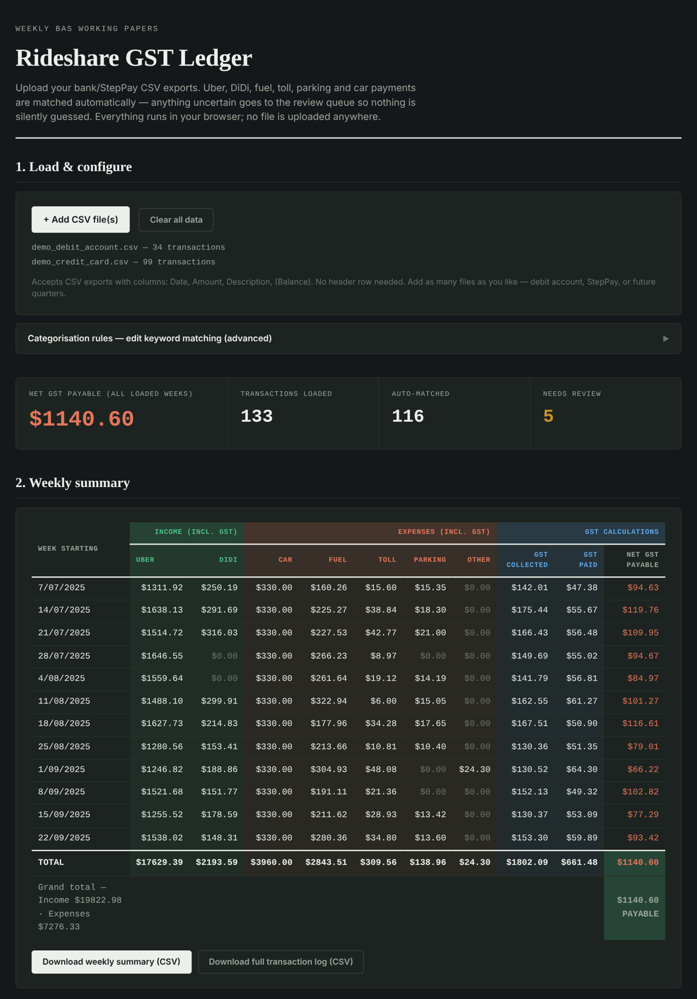
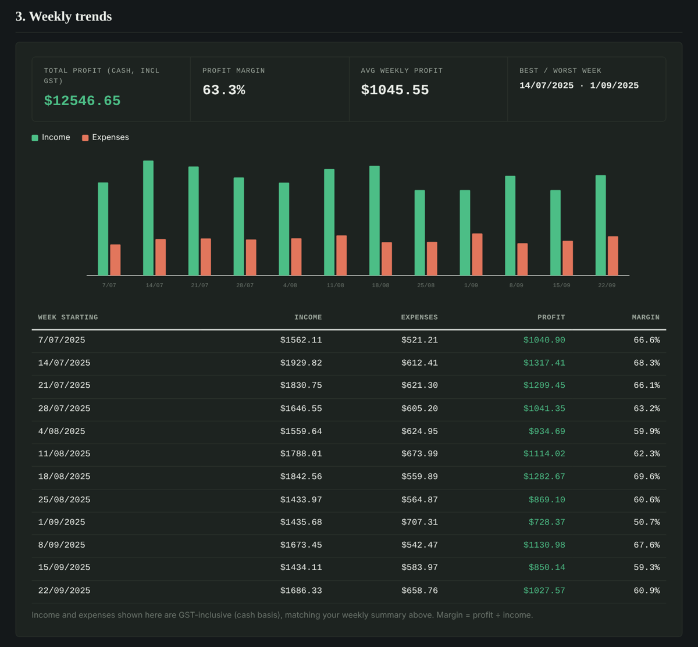
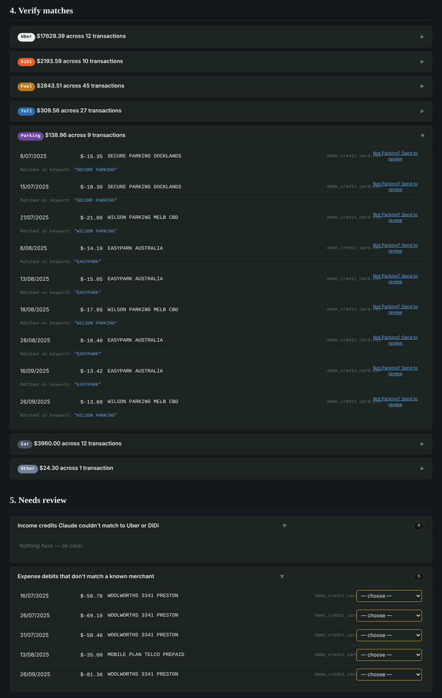
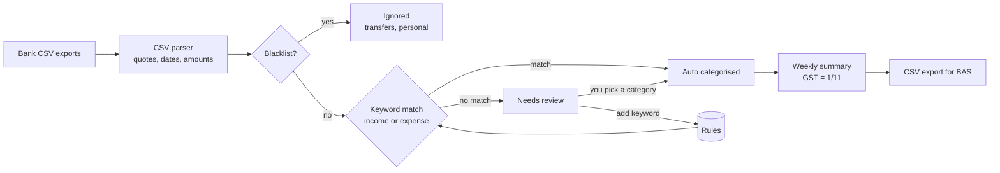

# Rideshare GST Ledger

An offline tool I built to turn raw bank statement exports into **weekly GST working papers for my BAS** as an Uber and DiDi driver in Australia.

Before this, I sorted every fuel, toll and parking transaction by hand in a spreadsheet each quarter. Now I drop in the CSV files and get a weekly GST summary in seconds. Anything the tool isn't sure about goes to a review queue, so nothing is silently guessed.

> **Showcase only.** The source isn't published. All screenshots use made-up demo transactions, not real bank data.

---

## The problem

Rideshare drivers registered for GST lodge a BAS each quarter. That means:
- separating Uber and DiDi income from personal transactions
- finding every claimable expense (fuel, tolls, parking, car rental, car wash, phone) across several accounts
- working out GST collected and GST paid (1/11 of GST inclusive amounts)

Bank exports are messy. The same merchant appears in many formats (`BP EXPRESS CRAIGIEBURN`, `7-ELEVEN 2241 BRUNSWICK AUS Card xx1234`), and transfers between your own accounts must not be counted at all.

## What it does

| Step | What happens |
|---|---|
| **1. Load** | Drop in any number of CSV exports (debit account, credit card, BNPL). Runs entirely in the browser; nothing is uploaded. |
| **2. Categorise** | Keyword rules sort each transaction into Uber, DiDi, Fuel, Toll, Parking, Car or Other. A blacklist removes transfers and personal payments. |
| **3. Summarise** | Weekly (Monday start) totals per category, GST collected, GST paid and **net GST payable**. |
| **4. Trends** | Weekly income vs expenses chart, profit, margin, and best and worst weeks. |
| **5. Verify** | Every auto match shows which keyword triggered it, with one click to send a wrong match back to review. |
| **6. Review** | Unmatched transactions wait for a manual category. The tool suggests a clean keyword so you can add a rule and never tag that merchant again. |
| **7. Export** | Weekly summary CSV for the BAS and a full transaction log CSV for records. |

## Screenshots

**Weekly trends:** income vs expenses, profit and margin per week

**Verify and review:** each match shows its keyword; unknown merchants wait in a review queue

## How it works

**Design decisions:**
- **Privacy first.** It's a single offline HTML file with no server and no libraries, so bank data never leaves the computer.
- **Nothing is guessed silently.** Income credits only count when they match an Uber or DiDi rule, and expense debits only when they match a known merchant. Everything else goes to review.
- **Word boundary keyword matching.** `BP` matches `BP EXPRESS` but not `BPAY`. This kills a whole class of false matches that simple "contains" searches get wrong.
- **Rules that learn.** Fixing a transaction in the review queue offers a ready-made keyword (card numbers, store numbers and state codes stripped out) to add with one click. Rules are saved in the browser and can be exported or imported as JSON.
- **Blacklist first.** Transfers between your own accounts and personal payments are removed before categorising, so they can't inflate income or expenses.
- **Cash basis, GST inclusive.** Matches how a sole trader rideshare driver typically reports, with GST worked out as 1/11 of each amount.

## Built with

Vanilla JavaScript, HTML and CSS in one self-contained file, with a hand-drawn SVG chart and browser `localStorage` for rules. I designed the workflow, rules and edge cases, and built it with Claude as an AI coding assistant. I use it on my own bank statements to prepare my quarterly BAS.

## Note

This tool organises working papers. It isn't tax advice. Totals should be checked before lodging a BAS.
